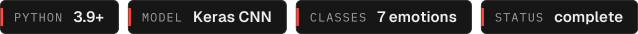

<p align="center"><a href="https://adithyapoojary.is-a.dev"><picture><source media="(prefers-color-scheme: light)" srcset=".github/readme/banner-light.svg"></picture></a></p>
<p align="center"><picture><source media="(prefers-color-scheme: light)" srcset=".github/readme/badges-light.svg"></picture></p>

Emotion Analyser reads facial expressions from a live webcam and labels each face with one of seven emotions. A compact CNN project for anyone learning how training and real-time inference fit together.

## Highlights

- **Seven emotions, live.** Angry, disgust, fear, happy, neutral, sad and surprise, drawn over each detected face as the video runs.
- **Your own model.** `trainmodel.py` builds and trains a four-block CNN (128, 256, 512, 512 filters) on 48x48 grayscale faces.
- **Training and inference kept apart.** Train once, then the lightweight `realtimedetection.py` only loads the saved architecture and weights.
- **Handy extras.** Plot the training curves from the saved history, or predict a single image, from the same script.

## How it works

1. OpenCV's Haar cascade finds faces in each webcam frame.
2. Each face is cropped, converted to grayscale, resized to 48x48 and normalised.
3. The CNN predicts one of seven classes.
4. The label and a box are drawn on the frame. Press `q` to quit.

## Quick start

Needs Python 3.9+, a webcam, and a face-expression dataset arranged as one folder per emotion (`angry/`, `disgust/`, `fear/`, `happy/`, `neutral/`, `sad/`, `surprise/`) under a `train/` and a `validation/` directory. The trained weights are not in the repo, so train first.

```bash
git clone https://github.com/NullSecurity07/Emotion-Analyser.git
cd Emotion-Analyser
python -m venv venv && source venv/bin/activate
pip install -r requirements.txt

# train (writes emotiondetector.json, emotiondetector.h5 and history.json)
python trainmodel.py --train_dir path/to/train --test_dir path/to/validation --epochs 100

# run on the webcam
python realtimedetection.py
```

Other options: `python trainmodel.py --plot_history history.json` and `python trainmodel.py --predict_image face.jpg`.

## Project layout

```
trainmodel.py           build, train, plot history, predict one image
realtimedetection.py    webcam inference
emotiondetector.json    model architecture (weights are created by training)
```

## Status

Complete learning project, not under active development. The weights file is not published, so results depend on the dataset you train with.

## Built by

Built by [Adithya Poojary](https://adithyapoojary.is-a.dev), founder of ThreatScope. [More projects](https://adithyapoojary.is-a.dev/work/) · [LinkedIn](https://www.linkedin.com/in/adithyapoojary/)

## License

MIT. See [LICENSE](LICENSE).
